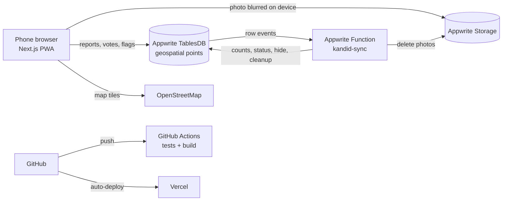

# Kandid

**See it. Report it.**

[](https://github.com/musthaqahmedg/kandid/actions/workflows/ci.yml)


**Live:** https://kandid-vert.vercel.app

Kandid lets citizens report civic problems (potholes, garbage, broken streetlights, water leaks, blocked drains) with a live photo, GPS location and time. Every report stays public on a map, with an "open for X days" counter, until people on the spot confirm it's actually fixed.

> *Kandu* (കണ്ടു) means "saw it" in Malayalam. Kandid = *kandu* + *candid*. Starting in Palakkad, Kerala.

## Why

Government complaint portals can close complaints quietly. Kandid keeps a public, photo-backed record that only closes when the community confirms the fix, and makes it one tap to share a report or file it with the official channel.

## Features

| | |
|---|---|
| 📷 **Report on the spot** | Live camera photo, automatic GPS and time. The pin can be fine-tuned, but only within 200 m of the live GPS, so reporters must actually be there. |
| 🔒 **On-device privacy blur** | Faces, and heads of people further away, are detected **in the browser** (MediaPipe BlazeFace + EfficientDet-Lite) and pixelated before upload. Tap to blur anything else, like number plates. The original photo never leaves the phone. |
| 🗺️ **List and map** | Pins coloured by status (Open → Acknowledged → Fixed), "Near me", "Open for X days" / "Fixed in X days". |
| 👍 **"I saw this too"** | Upvotes show how many people care. |
| ✅ **Community-verified fixes** | People within 200 m confirm "It's fixed" (with an after photo) or "Still broken". Closes when the reporter or 3 people confirm; reopens if more say it's still broken. Reporter rates the fix 1–5★. Before/after photos. |
| 📨 **Make it count** | Share via WhatsApp / X / the phone's share sheet, copy a ready-made complaint, and get the right official channel per issue type (PWD 4U, K-SMART, CM's Grievance Cell). Record "I filed it" with a reference number. |
| 🚩 **Safety** | Private flags; 3 distinct flags hide a report for review. Reporters can delete their reports; users can delete their account and all data. |
| 🔑 **Login** | Email one-time code or Google (token flow that works on iPhone Safari without third-party cookies). |
| 📱 **PWA** | Installable on iPhone and Android home screens. |

## Architecture



**Trust model:** users can create their own rows, but only the server function can change a report's status or counts.

- A vote counts only if it was really created by the user it names (checked via row permissions), was cast within 200 m of the report, and, for "fixed", includes an after photo.
- Upvotes and flags are counted per distinct user, and a reporter's flag on their own report doesn't count.
- Deleting a report removes its photos, votes, filings and flags; deleting an account removes everything the user created.
- The rules live in pure functions (`functions/kandid-sync/src/rules.js`) with unit tests run in CI.

## Tech stack

- **Frontend:** Next.js 16 (App Router), React 19, TypeScript, PWA
- **Maps:** Leaflet + OpenStreetMap
- **On-device AI:** MediaPipe Tasks Vision (BlazeFace, EfficientDet-Lite)
- **Backend:** Appwrite Cloud: Auth (email OTP, Google OAuth), TablesDB with geospatial `point` columns, Storage (encrypted, antivirus), Functions (Node 22, event-triggered)
- **Hosting:** Vercel, auto-deploy from `main`
- **CI:** GitHub Actions (unit tests, type-check, build)
- **Built with an AI coding agent** as pair programmer

## Project structure

```
src/app/                 pages: feed + map, /report, /r/[id], /login, /account, /privacy, /terms
src/lib/appwrite.ts      Appwrite client, types, helpers
src/lib/privacy.ts       on-device face/person detection and pixelation
functions/kandid-sync/   server function: counts, closing rules, moderation, cleanup
.github/workflows/       CI
```

## Run locally

```bash
npm install
cp .env.example .env.local
npm run dev     # http://localhost:3000
npm test        # rules unit tests
```

## Roadmap

- Auto-detect the ward / constituency from the location and show the responsible councillor and MLA
- Ward scorecards: issues open vs fixed, average days to fix
- AI: photo → category and severity; duplicate detection
- Malayalam language support
- Native app with Expo

## License

MIT. Kandid is a product of MAG Infosystems and is not a government service.
